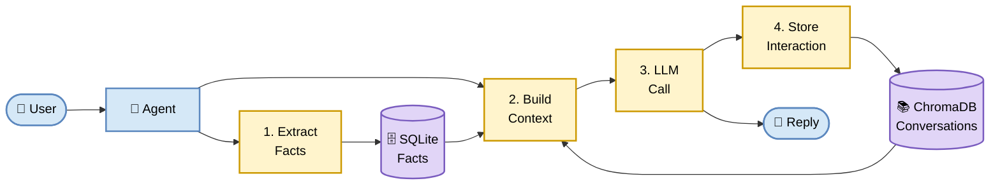

# 🧠 Persistent Memory Agent

> A chatbot that **actually remembers you** — your name, your past conversations, your preferences — even after you close the terminal.

---

## The Problem

Every chatbot forgets you the moment you close the window. Ask it your name twice, it asks back twice.

**This one doesn't.**

---

## What It Does

Two memories, one agent:

- 🗣️ **Episodic Memory** — *"What did we talk about last time?"*
  → ChromaDB (vector DB, similarity search)

- 📌 **Semantic Memory** — *"What is the user's name?"*
  → SQLite (relational DB, exact lookup)

Every message makes it smarter about you.

---

## Architecture



**Why the order matters:** Facts are saved *before* the LLM call. So if the user corrects themselves ("I'm not a developer, I'm a data scientist"), the fresh fact is already in context.---

---

## Why Two Databases?

| Question | Tool | Why |
|----------|------|-----|
| "Find similar conversations" | ChromaDB | Similarity search |
| "Get user's name" | SQLite | Exact key lookup |

Different questions → different tools.

---

## Stack

- **Python 3.11**
- **LangChain** — LLM orchestration
- **Ollama** (local) or **Groq** (cloud) — the brain
- **ChromaDB** — episodic memory
- **SQLite** — semantic memory
- **FastAPI** — REST API
- **sentence-transformers** — embeddings

---

## Quick Start

```bash
# 1. Install
conda create -n env python=3.11 -y
conda activate env
pip install -r requirements.txt --only-binary=all

# 2. Pull local model
ollama pull qwen2.5:1.5b

# 3. Configure
cp .env.example .env
# edit .env → LLM_PROVIDER=ollama (or groq)

# 4. Run
python main.py                     # CLI
# or
uvicorn api.main:app --reload      # Web API
```

---

## Try It

**Session 1:**
```
You: I'm a data scientist from Islamabad.
You: I love biryani.
You: quit
```

**Session 2 (next day):**
```
You: What do you know about me?
Agent: You're a data scientist from Islamabad, and you love biryani.
```

It remembers. Because:
- Facts → SQLite
- Conversations → ChromaDB

---

## API Endpoints

| Method | Endpoint | What it does |
|--------|----------|--------------|
| `GET` | `/` | Health check |
| `POST` | `/chat` | Send a message |
| `GET` | `/facts` | List all facts |

**Interactive docs:** `http://localhost:8000/docs`

**Example:**
```bash
curl -X POST http://localhost:8000/chat \
  -H "Content-Type: application/json" \
  -d '{"message": "My name is Haider"}'
```

---

## Project Structure

```
persistent-memory-agent/
├── api/main.py               # FastAPI endpoints
├── memory/
│   ├── episodic_memory.py    # ChromaDB
│   └── semantic_memory.py    # SQLite
├── agent.py                  # Core logic
├── main.py                   # CLI
├── requirements.txt
└── .env
└── .env.example
```

---

## Design Choices

**Why split memories?** Because "find similar conversations" and "get user's name" are different problems. One needs similarity, the other needs exactness.

**Why extract facts with LLM?** Users say "I'm Ali", "name's Ali", "call me Ali" — infinite patterns. LLM understands them all.

**Why local + cloud?** Free to run locally, fast to run on Groq. One switch in `.env`.

---

## Limitations

- No memory decay — old conversations stay forever
- Single-user design (no auth)

---

## Roadmap

- [ ] Memory decay (older = less weight)
- [ ] Multi-user support
- [ ] Streaming responses
- [ ] Web UI
- [ ] Docker

---

## License

MIT — free to use, modify, share.